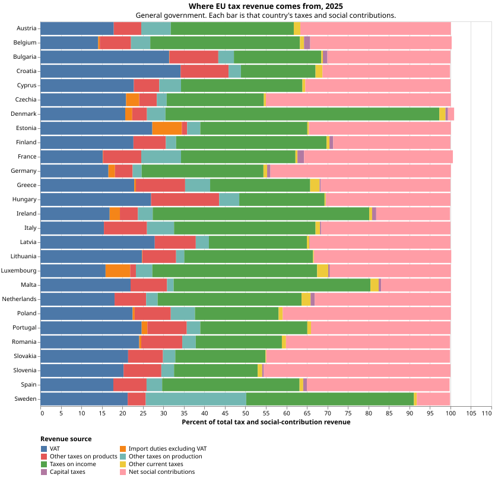

# EU Tax Revenue Sources

Collect and create infographics about EU tax revenue sources by country.



## Data

Eurostat is the source. Tax revenue is main national accounts tax aggregates, online data code `gov_10a_taxag`. Population is national accounts population and employment, online data code `nama_10_pe`.

| | |
| --- | --- |
| Dataset | [gov_10a_taxag in the Eurostat data browser](https://ec.europa.eu/eurostat/databrowser/view/gov_10a_taxag/default/table?lang=en) |
| Metadata | [ESMS reference metadata](https://ec.europa.eu/eurostat/cache/metadata/en/gov_10a_taxag_esms.htm) |
| DOI | [10.2908/gov_10a_taxag](https://doi.org/10.2908/gov_10a_taxag) |
| Statistics explained | [Tax revenue statistics](https://ec.europa.eu/eurostat/statistics-explained/index.php?title=Tax_revenue_statistics) |
| API call the download script uses | `https://ec.europa.eu/eurostat/api/dissemination/sdmx/2.1/data/gov_10a_taxag?format=SDMX-CSV&compressed=true` with `Accept: application/vnd.sdmx.data+csv;version=1.0.0` |

The series is ESA 2010 table 0900, “Detailed tax and social contribution receipts by type of tax and social contribution and receiving subsector.” National statistical offices report it. Values are current prices for the calendar year, for general government and its subsectors, plus the institutions of the EU.

The download checked on 10 November 2026 (Europe/Copenhagen) carries `LAST UPDATE` = `05/11/26 23:00:00` on every row (the stamp stored in the Eurostat file). That extract has 2,619,839 annual observations and these dimensions:

- `freq`: `A` (annual).
- `TIME_PERIOD`: 1995–2025. Legal transmission starts in 1995; a few series are shorter.
- `geo`: EU member states; Iceland, Norway, and Switzerland; EU and euro-area aggregates, including `EU27_2020` and `EA21`.
- `sector`: `S13` general government, `S1311` central, `S1312` state, `S1313` local, `S1314` social security funds, `S212` EU institutions, and `S13_S212` general government plus EU institutions.
- `unit`: `MIO_EUR` (million euro), `MIO_NAC` (million units of national currency), `PC_GDP` (percentage of GDP), `PC_TOT` (percentage of total tax and social-contribution revenue in that sector).
- `na_item`: 93 ESA tax and social-contribution codes. The file keeps the published codes, including the totals and the parts. Codes used for a country comparison include `D211` VAT, `D212` import duties excluding VAT, `D214` other taxes on products, `D29` other taxes on production, `D51` taxes on income, `D51A` taxes on individual or household income, `D51B` taxes on the income or profits of corporations, `D51C1` and `D51C2` holding gains of households and corporations, `D59` other current taxes, `D91` capital taxes, `D61` net social contributions, and `D995` taxes and social contributions assessed but unlikely to be collected. `D51A` and `D51B` are in the classification; countries report them on a voluntary basis, so some members have `D51` for a year and no household or corporate split.

### Population and employment

| | |
| --- | --- |
| Dataset | [nama_10_pe in the Eurostat data browser](https://ec.europa.eu/eurostat/databrowser/view/nama_10_pe/default/table?lang=en) |
| Metadata | [ESMS reference metadata](https://ec.europa.eu/eurostat/cache/metadata/en/nama_10_pe_esms.htm) |
| DOI | [10.2908/nama_10_pe](https://doi.org/10.2908/nama_10_pe) |
| API call the download script uses | `https://ec.europa.eu/eurostat/api/dissemination/sdmx/2.1/data/nama_10_pe?format=SDMX-CSV&compressed=true` with `Accept: application/vnd.sdmx.data+csv;version=1.0.0` |

`nama_10_pe` is annual population and employment on the national-accounts basis. Total population is `na_item` `POP_NC` and `unit` `THS_PER`: thousands of persons, the annual average number of people permanently settled in the economic territory. The file also keeps employment (`EMP_NC`, `EMP_DC`, `SAL_NC`, `SAL_DC`, `SELF_NC`, `SELF_DC`) and the percentage-change unit `PCH_PRE_PER`.

The download checked on 10 November 2026 (Europe/Copenhagen) carries `LAST UPDATE` = `21/10/26 23:00:00` on every row (the stamp stored in the Eurostat file). That extract has 16,934 annual observations for 1975–2025. For 2025, all 27 members have a `POP_NC` / `THS_PER` value. Germany is 83,513 thousand. Twelve of those 27 figures are flagged provisional (`OBS_FLAG` = `p`): Belgium, Croatia, Cyprus, France, Germany, Greece, Hungary, Italy, Luxembourg, the Netherlands, Portugal, and Spain.

Each dataset is saved as one Parquet file under `data/`, which is gitignored: `data/gov_10a_taxag.parquet` and `data/nama_10_pe.parquet`. Column names match that file's SDMX-CSV header. The tax file's columns are `DATAFLOW`, `LAST UPDATE`, `freq`, `unit`, `sector`, `na_item`, `geo`, `TIME_PERIOD`, `OBS_VALUE`, `OBS_FLAG`, and `CONF_STATUS`. The population file has that set without `sector`. Codes and flags are strings, the year is an integer, and the value is a double.

## Quickstart

```bash
uv run python scripts/download_eurostat.py # download Eurostat datasets into data/
uv run marimo edit notebooks/tax_shares.py # explore the 2025 tax-share chart
uv run ruff check --fix # lint
uv run ruff format # format
```

## Tech Notes

- Python 3.15
- Marimo

### Files and Directories

- `data/` — downloaded Parquet, one file per Eurostat dataset: `gov_10a_taxag.parquet` and `nama_10_pe.parquet`. Not in git. Recreate them with the download script.
- `assets/tax_shares_2025.svg` — chart written by the notebook, and the illustration above.
- `scripts/download_eurostat.py` — fetches the datasets listed in that script.
- `notebooks/tax_shares.py` — loads the Parquet and draws the chart.

## Literature
See related projects for inspiration:

- Visual Capitalist, [Where Each U.S. State Gets Its Tax Revenue From](https://www.visualcapitalist.com/where-each-states-tax-revenue-comes-from/) (26 October 2026). Inspiration for comparing members side by side. This project follows the Eurostat classification below.
- Tax Foundation, [Sources of Government Revenue in the OECD, 2025](https://taxfoundation.org/data/all/global/oecd-tax-revenue-by-country/) (Cristina Enache, 22 May 2025).
- Tax Foundation code and output tables for that publication: [TaxFoundation/sources-of-government-revenue](https://github.com/TaxFoundation/sources-of-government-revenue/).
